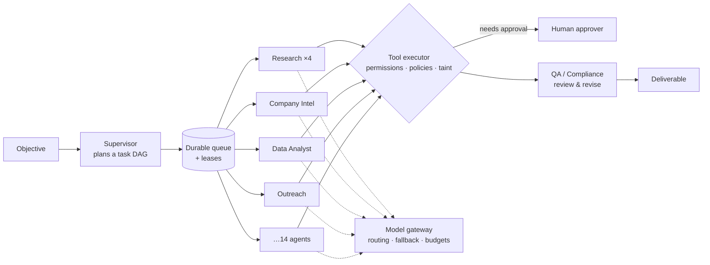

# AgentOS — Enterprise Multi-Agent Digital Workforce Platform

AgentOS turns a business objective into a plan of tasks, assigns them to specialised AI agents,
and runs them to completion: in parallel where it can, through QA review loops, under
organisation policies, and with humans approving the actions that matter. Every step, tool
call, model call and decision is recorded, observable and replayable.

It is a platform, not a chatbot. Agents, tools and policies are data that you configure at
runtime, and execution is a durable task graph that survives worker crashes, provider outages and
restarts.



## Highlights

- **Supervisor planning.** An objective becomes a validated task DAG with dependencies,
  capabilities, budgets and review criteria. Plans that fail validation (unknown agents, cycles,
  missing dependencies, size limits) go back to the Supervisor with the validator's error.
- **14 built-in agents:** Supervisor, Research, Company Intel, Data Analyst, CRM, Outreach,
  Document, Operations, QA/Critic, Compliance, Support Triage, Knowledge, Technical and Risk
  Evaluator. They are stored as database records, so you can edit or add agents without
  deploying.
- **Agent runtime** with a structured THINK → PLAN → SELECT_TOOL → EXECUTE_TOOL → OBSERVE →
  EVALUATE → COMPLETE loop. It validates decisions against a schema and repairs malformed output,
  detects loops, limits delegation depth and fan-out, and checkpoints every step.
- **Governed tools.** 26 tools across research, CRM, email, Slack, refunds, documents,
  knowledge, data and code. Each has read, write, external or privileged permission levels,
  timeouts and retries. Every call is authorised by a policy engine (deny › require QA › require
  approval › allow).
- **Human-in-the-loop approvals.** Approvers see the exact payload, matched policies and risk, and
  can approve, reject, edit or request changes, gated by role (for example only a finance manager
  can approve a $5,000 refund).
- **Prompt-injection defence in depth:** sanitisation, detection, neutralisation, untrusted-data
  envelopes, and taint tracking that forces approval when untrusted content steers an outbound
  action.
- **Model gateway.** Routes by purpose to economy, standard or advanced tiers across OpenAI,
  Anthropic and a local engine, with fallback, circuit breakers, token and cost accounting, and
  budget-driven downgrades. Runs fully offline with no API keys.
- **Knowledge and memory.** Hybrid (semantic + keyword, RRF) retrieval with citations and
  classification-based access control, layered memory with human approval of organisational
  knowledge, and an entity graph.
- **Reliability.** Redis reliable queue, task leases, a crash-recovery sweep,
  resume-from-checkpoint, retries with backoff, and chaos injection for providers, tools and
  workers.
- **Operations console** (React): live task graphs, agent collaboration, run replay, an approvals
  inbox, agent, tool and policy editors, knowledge search, memory and entity graph, costs, a
  hash-chained audit log, and settings.
- **Production packaging:** Docker images, Docker Compose with Prometheus, Grafana and Jaeger,
  Kubernetes manifests with autoscaling, Alembic migrations, and CI.

## Quick start

**Docker Compose** (PostgreSQL, Redis, API, two workers, console, Prometheus, Grafana, Jaeger):

```bash
docker compose up -d --build
open http://localhost:8080          # sign in: admin@sentinel.example / AgentOS!2026
```

**Local development:**

```bash
cd backend && python3.12 -m venv .venv && .venv/bin/pip install -e ".[dev]"
.venv/bin/uvicorn app.main:app --reload --port 8000

cd frontend && npm ci && npm run dev  # http://localhost:5173
```

Then follow [the demo guide](docs/DEMOS.md): start the **B2B sales intelligence** project or
submit the **support tickets**, and approve what the agents ask for.

## Flagship demos

| Demo | What it shows |
|---|---|
| **Autonomous B2B sales intelligence** — "find 100 qualified UK companies … prepare the best 20 prospects for approval" | Parallel research agents, delegation, scoring, a QA revision loop on outreach, compliance checks, approval-gated email and CRM writes, a ranked deliverable |
| **Customer support operations** — three tickets from a helpdesk webhook | Triage, CRM lookup, cited RAG answers, risk-based routing, a finance-manager refund approval, a neutralised prompt injection, automatic low-risk replies |

## Repository layout

| Path | Contents |
|---|---|
| `backend/app/api` | FastAPI routes, auth, RBAC, rate limiting |
| `backend/app/services/orchestrator.py` | Task DAG scheduling, review loops, approvals, escalation, recovery |
| `backend/app/services/agents` | Agent runtime loop and checkpoints |
| `backend/app/services/planning` | Supervisor planner and DAG validation |
| `backend/app/services/tools` | Tool registry, built-in tools and the governed executor |
| `backend/app/services/policy` | Policy condition DSL and decision engine |
| `backend/app/services/model_gateway` | Providers, routing, circuit breakers and the local model engine |
| `backend/app/services/rag`, `memory.py` | Parsing, chunking, embeddings, hybrid retrieval; memory and entity graph |
| `backend/app/services/security` | Prompt-injection defences |
| `backend/app/seed` | Built-in agents, policies, demo organisations, knowledge and CRM data |
| `backend/migrations` | Alembic migrations |
| `backend/scripts` | Load test, HTTP smoke test, in-process B2B smoke run |
| `backend/tests` | Unit, integration and end-to-end tests |
| `frontend/` | React 19 + Vite + Tailwind console |
| `deploy/` | Kubernetes manifests, Prometheus rules, Grafana dashboards |
| `docs/` | Product, architecture, runtime, API, security, operations and demo documentation |

## Documentation

- [Product requirements](docs/PRD.md)
- [System design](docs/DESIGN.md)
- [Architecture](docs/ARCHITECTURE.md): components, data model, lifecycle, queue and recovery,
  deployment
- [Agent runtime, tools, policies, model gateway and memory](docs/AGENT_RUNTIME.md)
- [HTTP API reference](docs/API.md)
- [Security model](docs/SECURITY.md)
- [Operations guide](docs/OPERATIONS.md): configuration, observability, scaling, runbooks,
  load-test results
- [Demo guide](docs/DEMOS.md)

## Testing

```bash
cd backend && .venv/bin/ruff check . && .venv/bin/pytest -q     # 136 tests
cd frontend && npm run typecheck && npm test && npm run build
cd backend && .venv/bin/python scripts/load_test.py --projects 40 --workers 12 --chaos 0.1
```

In the reference load test, 40 concurrent projects (480 tasks) with 10% injected provider
failures, plus tool failures, malformed output and simulated worker crashes, all completed in 60
seconds with no stalled or failed projects
([details](docs/OPERATIONS.md#51-load-test)). CI runs lint, tests, a smaller load test, PostgreSQL
migration checks, manifest validation and image builds on every push.

## Earlier sample

The repository began as a minimal single-agent tool-calling loop in C#/.NET. Its sources remain
at the root; see [docs/dotnet-agent.md](docs/dotnet-agent.md).
