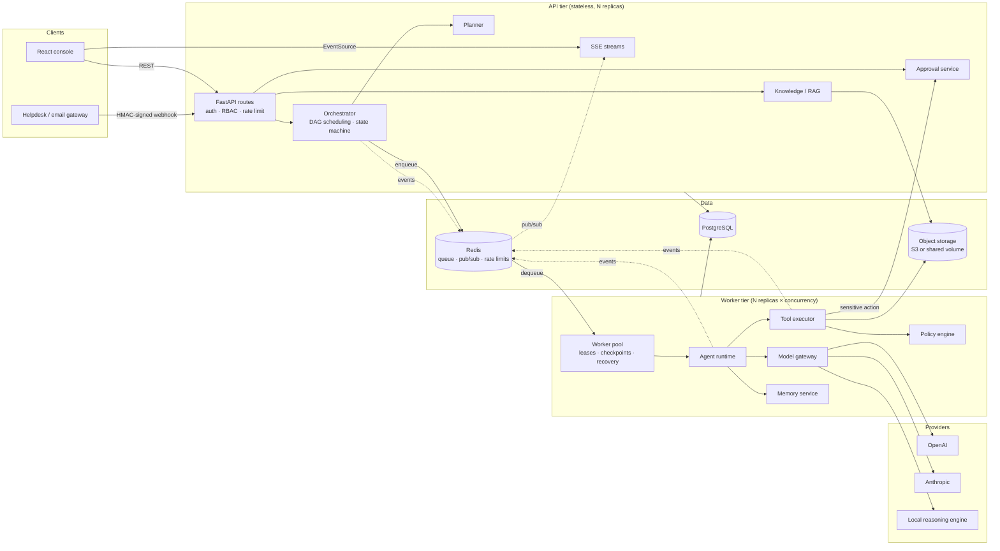
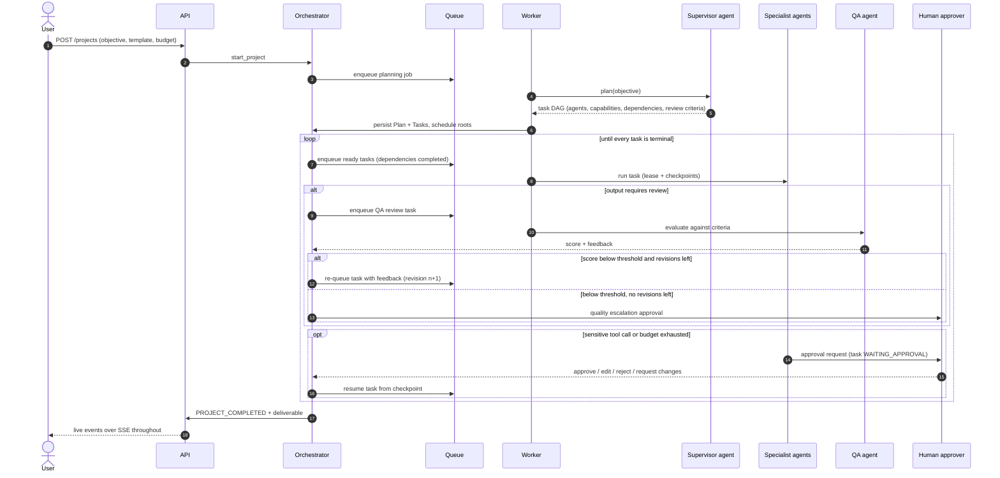
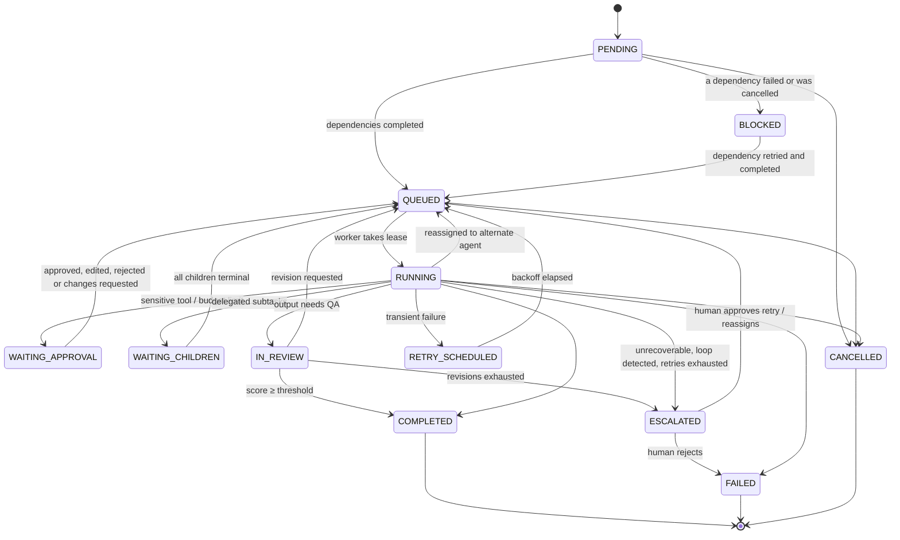
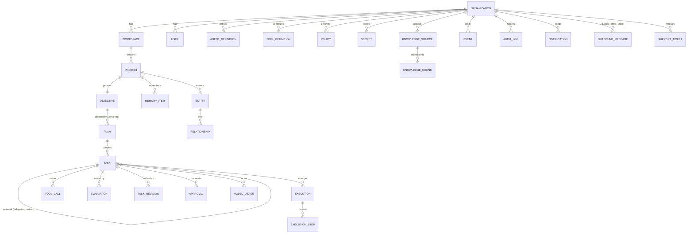
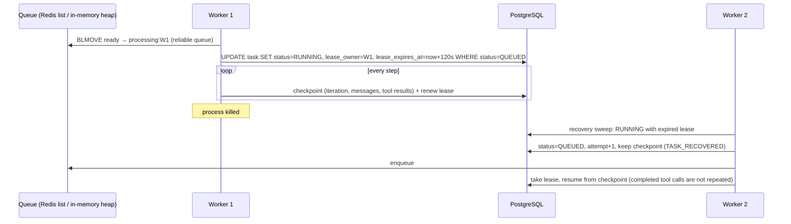
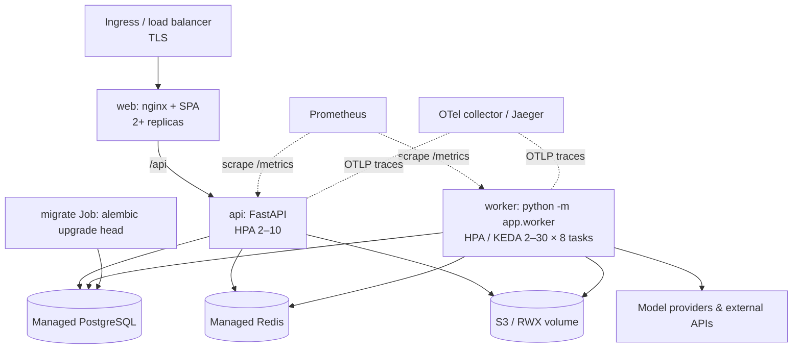

# AgentOS — Architecture (as built)

AgentOS turns a business objective into a plan of tasks, assigns them to specialised agents,
executes them with governed tools, checks their output, pauses for humans where policy requires,
and keeps an auditable record of everything. This document describes how the code is put
together. [`AGENT_RUNTIME.md`](AGENT_RUNTIME.md) covers the agent loop, model gateway and memory in
depth; [`SECURITY.md`](SECURITY.md) covers the threat model.

## 1. Components

| Package | Responsibility |
|---|---|
| `app/api/routes/` | REST surface: auth, org, agents/tools/policies, knowledge, projects/tasks, approvals, memory, costs, audit, business data, webhooks, system |
| `app/services/orchestrator.py` | Owns every task state transition: scheduling dependents, delegation, QA reviews, approvals, retries, escalation, budget pauses, recovery, cancellation |
| `app/services/planning/` | Objective → validated task DAG (`dag.py` checks acyclicity, agent/capability existence, size limits) |
| `app/services/worker.py` | Worker pool: dequeues jobs, takes a database lease on the task, runs the runtime, renews/expires leases, periodic recovery sweep |
| `app/services/agents/` | Agent profile (from DB), context builder, decision parser with repair, runtime loop |
| `app/services/tools/` | Tool base class + registry, 26 built-in tools, the executor pipeline |
| `app/services/policy/` | Condition DSL and decision engine over the `policies` table |
| `app/services/model_gateway/` | Model catalogue, router, providers, circuit breakers, fallback, fault injection, usage metering; local reasoning engine |
| `app/services/rag/` | Parsing (PDF, DOCX, HTML, CSV, Markdown, JSON), chunking, embeddings, hybrid retrieval with reciprocal-rank fusion |
| `app/services/memory.py` | Session and long-term memory, trust levels, promotion, semantic recall |
| `app/services/budget.py` | Budget state across organisation / project / agent / task scopes |
| `app/services/approvals.py` | Decision validation (RBAC, edit schema validation), resume semantics |
| `app/services/security/injection.py` | Sanitising, scanning, neutralising and fencing untrusted content |
| `app/services/audit.py` | Hash-chained append-only audit log and verification |
| `app/core/` | Settings, database engine/sessions, JWT + RBAC, crypto, event bus/outbox, telemetry |

One image runs as the API (`uvicorn app.main:app`) or as a worker (`python -m app.worker`). For
local development the API can also host an embedded worker pool (`AGENTOS_EMBEDDED_WORKERS`), so
`uvicorn` alone runs the whole platform on SQLite with no Redis.

## 2. Project lifecycle

## 3. Task state machine

A rejected approval does not fail the task outright: the agent resumes, observes the rejection
as a tool result, and decides what to do next (for example, finish without sending). Only the
orchestrator writes task status; the runtime returns a `RunResult` and the orchestrator applies
the transition in one transaction together with its events.

## 4. Data model

34 tables in total (`migrations/versions/20261011_0001_initial_schema.py`), including the demo
CRM (`crm_accounts`, `crm_contacts`, `crm_opportunities`) and generated files. Every
tenant-owned table carries an indexed `org_id`; route handlers load rows through
`get_owned()`, which returns 404 for rows of another organisation, and list queries filter on
the caller's `org_id`. Tests attempt cross-tenant access on every resource type.

## 5. Events, outbox and live streams

Every state change emits an `EventRecord` in the same transaction as the change (a transactional
outbox). After commit the event bus publishes it, in-process and on Redis pub/sub when
configured, so any API replica can stream events produced by any worker. Clients subscribe with
`EventSource` to `/api/v1/projects/{id}/stream` or `/api/v1/events/stream` (the bearer token is
passed as `access_token` because `EventSource` cannot set headers). Because events are persisted,
the console's **Replay** tab can rebuild the full state of a past project at any point in time.

Event types: project (`CREATED`, `STARTED`, `COMPLETED`, `FAILED`, `CANCELLED`), `PLAN_CREATED`,
task (`CREATED`, `ASSIGNED`, `QUEUED`, `DELEGATED`, `REVIEW_STARTED`, `REVISION_REQUESTED`,
`RETRY_SCHEDULED`, `BLOCKED`, `ESCALATED`, `REASSIGNED`, `RECOVERED`, `COMPLETED`, `FAILED`,
`CANCELLED`), `AGENT_STARTED`, `AGENT_STEP`, tool (`CALLED`, `COMPLETED`, `FAILED`, `DENIED`),
model (`FALLBACK`, `DOWNGRADED`), approval (`REQUIRED`, `GRANTED`, `REJECTED`,
`CHANGES_REQUESTED`), budget (`WARNING`, `EXCEEDED`), `INJECTION_DETECTED`, `MEMORY_WRITTEN`.

## 6. Queue, leases and crash recovery

- Jobs carry only a task id. The database lease is the source of truth, so a duplicate
  delivery is harmless: the second worker fails the conditional update and drops the job.
- With Redis, a dequeued job moves atomically into a per-worker processing list and is removed
  only after the task attempt finishes; jobs held by dead workers are moved back to the ready
  list. Delayed jobs (retry backoff) wait in a sorted set until due.
- Each worker runs a recovery sweep at start-up and every `AGENTOS_RECOVERY_INTERVAL_SECONDS`.
  It re-queues tasks whose lease expired, tasks stuck in `QUEUED` whose job was lost, elapsed
  `RETRY_SCHEDULED` tasks, and projects stuck in `PLANNING`.
- Transient failures retry with exponential backoff (1 s, 2 s, 4 s … capped at 60 s) up to
  `max_attempts`, then reassign to the agent's `escalation_rules.alternate_agent` if set, and
  otherwise escalate to a human.

## 7. Deployment topology

See [`OPERATIONS.md`](OPERATIONS.md) for Compose and Kubernetes instructions, configuration and
runbooks.
